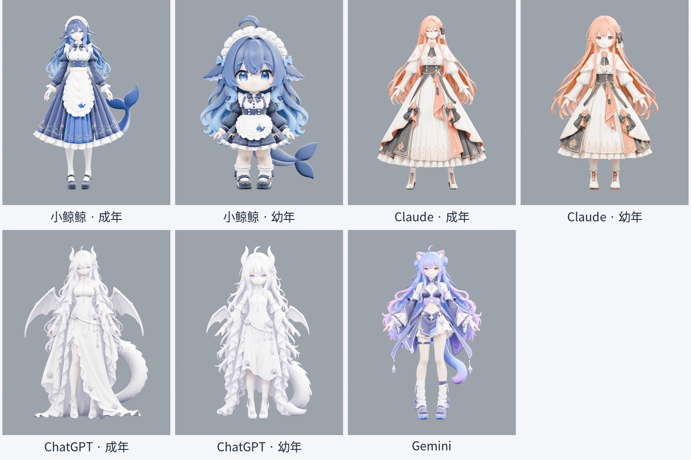

# AI Girls 3D · 小鲸鲸与朋友们

小鲸鲸、Claude、ChatGPT、Gemini 的 3D 角色资产。由 Manny 与 Codex 协作整理，包含成年及幼年版本，共 **7 个独立模型**。

**[下载 v1.0.0 模型](https://github.com/ningfangtianwai-pixel/ai-girls-3d/releases/tag/v1.0.0)** · [来源与署名](ATTRIBUTION.md) · [CC BY 4.0](LICENSE)

## 下载

| 角色 | 版本 | 独立下载 |
|---|---|---|
| 小鲸鲸 / DeepSeek | 成年 | [whale-adult.zip](https://github.com/ningfangtianwai-pixel/ai-girls-3d/releases/download/v1.0.0/whale-adult.zip) |
| 小鲸鲸 / DeepSeek | 幼年 | [whale-child.zip](https://github.com/ningfangtianwai-pixel/ai-girls-3d/releases/download/v1.0.0/whale-child.zip) |
| Claude | 成年 | [claude-adult.zip](https://github.com/ningfangtianwai-pixel/ai-girls-3d/releases/download/v1.0.0/claude-adult.zip) |
| Claude | 幼年 | [claude-child.zip](https://github.com/ningfangtianwai-pixel/ai-girls-3d/releases/download/v1.0.0/claude-child.zip) |
| ChatGPT | 成年 | [chatgpt-adult.zip](https://github.com/ningfangtianwai-pixel/ai-girls-3d/releases/download/v1.0.0/chatgpt-adult.zip) |
| ChatGPT | 幼年 | [chatgpt-child.zip](https://github.com/ningfangtianwai-pixel/ai-girls-3d/releases/download/v1.0.0/chatgpt-child.zip) |
| Gemini | 当前版 | [gemini.zip](https://github.com/ningfangtianwai-pixel/ai-girls-3d/releases/download/v1.0.0/gemini.zip) |

每包包括 `.blend`、自带贴图的 `.glb`、单独烘焙的基础颜色贴图、正面/四分之三预览、模型统计与许可。大文件保存在 Release，克隆仓库只获得说明、预览和索引。

## 使用

- **Blender**：用 Blender 4.5 LTS 或兼容版本打开 `.blend`。原材质图像已打包，无需本机路径或插件。`COL_Preview_Studio` 为预览相机与灯光；模型放在单独角色集合。
- **其他 3D 软件**：导入 `.glb`。基础颜色已烘焙并内嵌，保留可导出的形态键；不同渲染器的灯光与高级材质外观可能不同。
- **尺寸与方向**：Blender 使用米、Z 向上、角色正面为 -Y；glTF 按标准转换为 Y 向上。实际身高及网格统计见 [catalog](catalog)。
- **后续模之屋**：这些是 Blender/glTF 资产，当前未转换为 PMX，也未宣称已具备 MMD/VRM 标准骨骼、物理或表情规范。

## 当前完成度

这是剧场制作使用的现有模型公开版，保持现有网格和外观，不是重新精修的角色。成年小鲸鲸包含 25 根基础身体骨骼及口型/眉眼形态键；其他版本保留现有基础形态键，不含完整人体骨骼。个别角色的口部仍是贴图表现。所有包均为中性姿态，未附完整影片动作或配音。

网格包含 AI 生成的三角面，头发/裙摆细节可能融合，手部、口型、眼睑以及身体接触仍有精修空间；不应直接当作完整游戏/MMD 动捕角色。

## 许可

模型、衍生贴图、模型元数据和渲染预览采用 **CC BY 4.0**：允许分享、修改及商业使用，请保留署名、许可链接并标注修改。完整许可见 [LICENSE](LICENSE)，署名示例见 [ATTRIBUTION.md](ATTRIBUTION.md)。

角色及品牌名称仅用于识别同人主题，不表示官方授权产品或官方合作。
